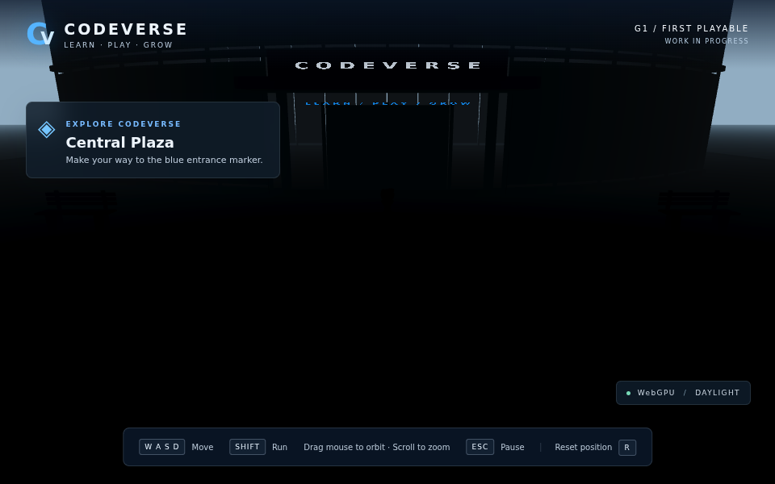
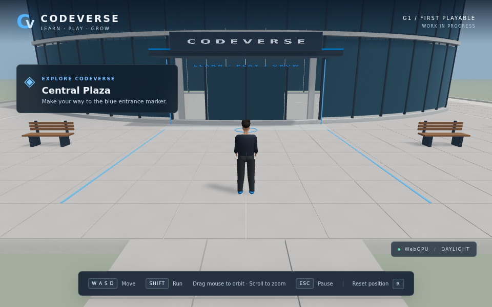

# G1 mostly-black rendering — diagnosis and correction

2026-11-27. Feature expansion paused. This investigation uses the **actual app in a browser**, not just unit tests or a stand-alone asset viewer.

## Before and after: same production WebGPU scene

**Before (reproduced):**



**After (same materials, lights, exposure and camera):**



Additional production captures: [whole site and road](evidence/g1-rendering/after/production-webgpu-overview.png), [front of character](evidence/g1-rendering/after/production-webgpu-character.png), [green foliage and brown trunk/soil](evidence/g1-rendering/after/production-webgpu-vegetation.png), [reload/resize](evidence/g1-rendering/after/production-webgpu-reload-resize.png). These are actual rendered screenshots, not generated concept images. The overview/character cameras are diagnostic shots; they do not change the normal spawn camera or expand gameplay.

## Root cause

`src/graphics/createRenderer.ts` called `scene.render()` directly before starting `engine.runRenderLoop()`, **outside an engine frame**. WebGL2 tolerated this, masking the defect in the earlier checks. WebGPU records work into command buffers: the first manual render left pending texture/resource uploads and draw work using a presentation target that expired before submission. WebGPU rejected the submission. The result was near-black PBR surfaces despite nonzero material colours, enabled lights, loaded assets and apparently ready meshes.

The failing production WebGPU console reported:

```text
[Frame 2] WebGPU uncaptured error (1): [object GPUValidationError]
Destroyed texture [Texture (unlabeled 960x600 px, TextureFormat::RGBA8Unorm)] used in a submit.
While calling [Queue].Submit([[CommandBuffer ... UploadEncoder], [CommandBuffer ... RenderEncoder]])
```

This was a GPU **validation warning**, not a JavaScript page exception or failed HTTP request. The old smoke test checked readiness/backend and page/network errors but did not reject these warnings or inspect pixel output. Its pass was insufficient, as the owner correctly reported.

## Actual fix

Bracket the first render with the engine's frame boundary so all recorded work is submitted before its target can expire:

```ts
engine.beginFrame();
try {
  scene.render();
} finally {
  engine.endFrame();
}
engine.runRenderLoop(render);
```

The normal managed render loop is unchanged. No switch to unlit/emissive materials, ambient brightness cheat, forced WebGL2 downgrade, palette replacement or exposure increase was used. Forced renderer semantics remain unchanged. The correction alone restored the production WebGPU image and removed the validation warning.

## Checks performed

| Area                              | Finding                                                                                                                                                                                                                                                                                   |
| --------------------------------- | ----------------------------------------------------------------------------------------------------------------------------------------------------------------------------------------------------------------------------------------------------------------------------------------- |
| Material colours/configuration    | Imported albedo values are nonblack; skin, shirt, navy clothing, blue shoes, pale bands/paving, blue glazing, brown wood/trunks and asphalt have assigned materials. Exactly the same values are present before/after. Dark clothing is intentionally dark, not a replacement silhouette. |
| Lighting/shadows                  | Both sky and sun are enabled (0.85 / 2.8 intensity); ACES exposure 1.15, contrast 1.05. Disabling shadows did **not** fix the black scene. Settings unchanged by correction.                                                                                                              |
| Environment illumination          | Raw procedural reflection cube ready, gamma-space flag true, intensity 0.65. No precomputed diffuse spherical polynomial; hemispheric light supplies diffuse sky fill. Removing the cube did **not** restore direct lighting. This is not a claim of a finished HDR lighting pipeline.    |
| Texture paths/colour space        | Local GLBs and paving maps load; embedded leaf images are packaged. No failed requests/HTTP errors in reproduced or corrected production captures. Readiness alone did not prove that queued GPU uploads had executed. Colour-map gamma settings were not changed to mask the failure.    |
| Shaders/console                   | No material shader compilation errors found; the relevant failure was the rejected WebGPU submission above. Corrected captures reject GPU-validation/uncaptured warnings as failures.                                                                                                     |
| Normals/faces/material assignment | Renderable meshes have normals and material assignments; shader readiness/error inspection recorded. Global winding/culling reversal was not needed: the same geometry becomes visible/coloured with the frame fix. Leaf cutouts remain double-sided.                                     |
| Scope/backend                     | Whole-scene PBR failure in WebGPU: building, paving, furniture and player affected, while UI/sky remained visible. WebGL2 rendered colours with the same assets. Not one missing/dark texture.                                                                                            |
| Development versus production     | Actual captures cover both builds and both successful renderer paths; automatic production selection is separately checked. See per-run JSON rather than inferring success from development alone.                                                                                        |

Isolation probe screenshots and console: `docs/evidence/g1-rendering/probes/`. They show that no-shadows, no-environment and no-tonemapping do not solve the failure; temporary unlit shading exposes base colours but does not repair missing GPU texture uploads. Probe changes were browser-only and are **not shipped as the fix**.

## Verification evidence and regression protection

- `docs/evidence/g1-rendering/before-vulkan/production-webgpu.json`: reproduced failing production WebGPU, full material/light/texture/mesh audit and GPU warning.
- `docs/evidence/g1-rendering/after/*.json`: actual corrected production/development captures, selected backend, console, shader errors, requests, readiness and pixel checks.
- `docs/evidence/g1-rendering/pixel-comparison.json`: central paving region (not UI) was **100% black, mean luminance 0/255** before; **0% black, mean approximately 193/255** after.
- Renderer lifecycle tests now assert `begin → render → end` on **both** backends, including `endFrame` cleanup when first rendering throws.
- `scripts/g1/diagnose-rendering.mjs`: screenshot/pixel and console audit against the actual app. `RENDER_ASSERT=1` rejects dark paving, GPU validation errors, failed requests, missing normals, unready meshes/textures and shader errors. It is not an FPS benchmark.
- Opt-in `?renderAudit=1` provides read-only diagnostic snapshots and scene access for investigation; no hook is installed on the normal URL, and it is removed on disposal.

**Completed checks:** all five successful paths passed screenshot/pixel and console/resource assertions: production WebGPU, production Auto (selected WebGPU), production WebGL2, development WebGPU, development WebGL2. Production WebGPU reload/resize was also clean. The unit suite passes 31 tests; the complete formatting/lint/typecheck/build check is recorded in the final verification summary.

The prior evidence is retained. The first software WebGPU attempt without Vulkan support failed during external-image copy; a supported software Vulkan configuration subsequently **reproduced the black scene and verified the fix**. Those are distinct outcomes, not silently treated as hardware success.

## Open the corrected game

The existing **CodeVerse G1 production preview (port 4173)** serves the rebuilt correction. Reload the preview tab (Ctrl+Shift+R if keeping an old tab open). The normal URL still prefers WebGPU when supported; `/?renderer=webgpu` and `/?renderer=webgl2` remain explicit diagnostic choices. There is no need to install asset tools, change graphics settings or force a different backend to obtain the fix.

This confirms visible restored colours in the tested production browser, not remote observation of the owner's laptop. Premium art, tailoring/gait, foliage density, and physical Windows/GPU/FPS acceptance remain incomplete. No new gameplay features were added.
