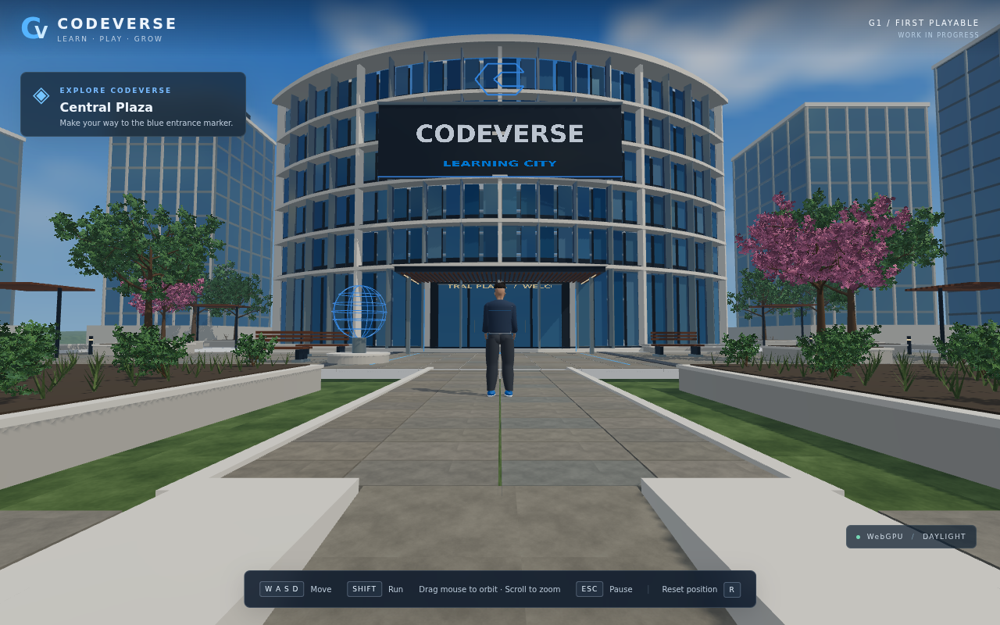

# G1 visual overhaul — review build

2026-11-27 · Actual application changes · No new gameplay systems · **Not premium visual acceptance**

This revision preserves the accepted [WebGPU initial-frame correction](g1-rendering-fix.md). It replaces the earlier construction-study presentation rather than claiming that restored colours alone meet the approved concept. Owner review of the playable scene remains necessary.

## What the screenshots and code showed

The earlier scene was basic for structural reasons: a tall repetitive shell with shallow facade treatment, little separation between glass and structure, a weak entrance, sparse planting and pink ellipsoid clusters, a small disconnected asphalt rectangle, broad uniform ground surfaces, basic fitted-body clothing and limited environment lighting. Increasing exposure would not address silhouette, depth, urban context, planting composition or garment construction.

The approved reference remains `docs/reference/codeverse-central-plaza-customization.png`. It is a design reference, not a runtime backdrop and not a claim that the current build matches its fidelity. No proprietary game art was extracted.

## Implemented visual work

- **Landmark:** compressed the original six-storey proportions; authored a new deep curved facade with recessed glazing, projecting mullions/fins, horizontal structural bands, prominent media panel, original open-C emblem, real door framing and a supported/slatted entrance canopy. The completed original construction/history remains available.
- **Plaza:** individually articulated paving courses/material families, basalt route bands, real terrace steps, flush central approach, continuous 1:12 ramp, retaining walls/coping, raised beds, timber benches and slatted pergolas. A static original blue orbital sculpture provides a civic focal point; it has no new interaction/system attached.
- **Road:** aggregate surface, extended scenery road rather than a floating test strip, separate sidewalks/curb units, edge lines/centre dashes, zebra crossing, drainage grilles, bollards and cantilever street luminaires. The controller remains within its original small road bounds; the visual extension is not drivable/explorable road gameplay.
- **Planting:** new seeded branched canopy/blossom/underplanting exports, leaf cutouts, different scale/rotation and layered shrubs/grass blades in authored beds. No opaque pink ellipsoids stand in for the revised blossom tree. This is still procedural planting, not scan-quality vegetation or a botanically validated flowering specimen.
- **Character:** original loose garment shells, sleeves/shoulder caps, lapels/pockets, shoe details, swept hair and sunglasses on the approved CC0 human source. Screenshot inspection exposed anatomical faces poking through clothing; occluded source faces were removed rather than merely recoloured. The existing skeleton and three original cycles remain, without introducing a customizer or new animation system.
- **Lighting/composition:** original directional cloud cubemap used for background/reflection, explicit sky irradiance, warmer directional sunlight, PCF shadows, material colour/normal/roughness response, wider/lower default camera and less intrusive UI. A later context addition exposed diagonal shadow acne; shadow projection was bounded around the playable plaza and distant context/ground batches excluded as casters.
- **Context:** original distant articulated podium/tower scenery and additional trees reduce the isolated-test-map composition. These are background architecture, not finished specialist buildings, interiors or a complete city.

## Rendered iteration trail

All images below come from the application in Chromium, not image generation.

| Run                               | What was checked / outcome                                                                                                                                                                                                                                                                                                                                              |
| --------------------------------- | ----------------------------------------------------------------------------------------------------------------------------------------------------------------------------------------------------------------------------------------------------------------------------------------------------------------------------------------------------------------------- |
| `docs/evidence/g1-visual/pass-1/` | First architectural/site/material pass. Actual spawn/entrance/overview inspected. Complete browser audit retained.                                                                                                                                                                                                                                                      |
| `pass-2/`                         | Added foliage/character/light iteration. Spawn inspection exposed vertically smeared sky clouds; sky function subsequently replaced. Five views retained, but capture timed out: **not a completed clean run**.                                                                                                                                                         |
| `pass-3/`                         | Optimized curved geometry/vegetation and corrected directional sky. Actual character, entrance, overview and foliage inspected. Character poke-through, isolated road and a camera inside foliage prompted further corrections. Complete browser audit retained.                                                                                                        |
| `pass-4/`                         | Extended context/road, garment correction, grass and sculpture. Actual spawn/character inspected. Diagonal shadow bands exposed a regression. Capture also recorded a screenshot timeout and was stopped; **not a clean final run**.                                                                                                                                    |
| `pass-5/`                         | Corrected shadow-fit and planting-camera recapture completed. All seven images inspected: broad diagonal bands gone, planting composition visible, garment poke-through corrected. No browser warnings/errors or failed requests; 291 audited meshes, all textures ready. Technical regressions are recorded separately in `docs/evidence/g1-visual/verification.json`. |

### Current review images

Additional views: [entrance](evidence/g1-visual/pass-5/entrance.png), [overview](evidence/g1-visual/pass-5/overview.png), [character](evidence/g1-visual/pass-5/character.png), [planting](evidence/g1-visual/pass-5/vegetation.png), [road](evidence/g1-visual/pass-5/road.png), [plaza](evidence/g1-visual/pass-5/plaza.png).

## Verification and sources

- `npm run check` passed formatting, lint, TypeScript, **32 unit tests** and production build. The real-input browser suite passed **9/9**, including controller traversal, ramp grounding, entrance information, collision, pause/reset and camera input. All six active GLBs validate with zero errors/warnings.
- Five backend-specific live paths passed: production WebGPU / Auto (selected WebGPU) / WebGL2, development WebGPU / WebGL2. Production WebGPU reload/resize also passed. Each defined paving sample had 0% black pixels, with no browser warnings/errors, failed requests, shader errors or unready textures. This preserves the accepted black-scene correction; it is not a reference-match score.
- Mixed-configuration software screenshot readbacks repeatedly timed out, including reduced/single/static-capture probes. Those runs are retained and **not** counted as passes. Successful WebGL2 runs use explicit ANGLE without the Vulkan WebGPU launch configuration; successful WebGPU runs use software Vulkan. The exact timeout cause is not claimed as established.
- Current code checks, exact browser outcomes and limitations: `docs/evidence/g1-visual/verification.json`.
- Current runtime SHA-256/byte inventory: `docs/evidence/g1-visual/runtime-assets.json`. The prior `g1/runtime-assets.json` is historical, not a validation of the revised files.
- Revised site/vegetation validator reports: `docs/evidence/g1-visual/`; revised hero validator/provenance: `docs/evidence/g1/hero-validation.json` and `public/assets/g1/hero-provenance.json`.
- Source/derivative notices: [VISUAL-SOURCES.md](../public/assets/g1/VISUAL-SOURCES.md), with existing CC0/MIT notices retained. All inputs are original or the already approved cached sources; no paid acquisition or new unverified marketplace package.
- Generators and optional authoring prerequisites: [G1 authoring notes](../scripts/g1/README.md). Packaged GLBs/maps are sufficient to build/play. No Blender retry, laptop installation or asset-tool download is needed to review this preview.

## Review the actual playable build

Open the existing **production preview on port 4173** and reload the tab. Default renderer selection remains WebGPU-first. `/?renderer=webgpu` and `/?renderer=webgl2` remain explicit diagnostics; forced backend failure must not silently switch engines.

WASD/arrows move; Shift runs; drag orbits; wheel zooms; R resets. Approach the entrance and press E for location information. Escape closes information or pauses. Spawn moved back to the approach so the whole landmark reads in the opening camera. The retained ramp, entrance interaction, collision and bounded traversal are unchanged in scope.

## Remaining gap — not a completion claim

The result is still more stylized and less materially/structurally nuanced than the approved cinematic reference. Character face, hands, garment folds/deformation and gait need substantial specialist refinement; glass is an opaque reflective architectural approximation with no finished interior behind it. The background buildings are repeated authored scenery, not a finished city. Procedural surface/foliage detail, ground contact and light integration remain below premium production art.

No traffic/NPCs, gameplay expansion, interiors, customization, multiplayer or fabricated HUD features were added to disguise that gap. No owner acceptance, Windows physical-GPU compatibility, HP Victus performance, sustained FPS/memory result or adaptive-quality delivery is claimed. Software Vulkan/SwiftShader browser checks establish only the explicitly tested rendering/controller paths. Passing them is **not** proof of premium appearance.
