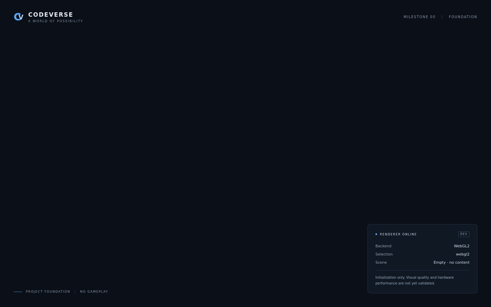

# Milestones and Milestone 0 report

> **Current execution update — 2026-11-27:** G1 was explicitly approved and an actual early playable is implemented. [Current handoff and evidence](g1-playable-handoff.md). The approval-pending/not-started wording in the historical roadmap and M0 report below is superseded; it is not a new implementation hold. No final G1 acceptance or later-system authorization is claimed.

> Current planning baseline: [Master Game Plan](master-game-plan.md), submitted for owner review on 2026-11-27. The gates and M0 report below preserve historical scope and evidence; use the master plan for the proposed forward roadmap. No new implementation is authorized.

## Gates

| Milestone                               | Objective                                                                                                                                                                        | Status / gate                                                                                                                                                              |
| --------------------------------------- | -------------------------------------------------------------------------------------------------------------------------------------------------------------------------------- | -------------------------------------------------------------------------------------------------------------------------------------------------------------------------- |
| 0 — Project foundation                  | Clean scaffold, empty renderer, diagnostics, tests, documentation                                                                                                                | Implemented; available checks passed; project-owner review pending                                                                                                         |
| 1 / G1 — Graphics Feasibility Benchmark | Independently validate visual quality, performance on the owner's physical hardware, and a practical repeatable production pipeline                                              | After A1 asset readiness under the master roadmap; implementation not started. Separate detailed execution approval required; all three categories must pass independently |
| Gameplay and later systems              | General character systems, multiplayer, vehicles, learning, progression, economy, broader city; narrowly scoped fixed-player benchmark validation is the sole proposed exception | Blocked until all three G1 categories pass and are owner accepted; preserve G2 and subsequent order in the master plan; each milestone requires its own approval           |

Every milestone requires an objective, implementation plan, approval before major changes, implementation, browser testing, actual visual evidence, acceptance criteria, and an honest completed/incomplete report. A1 must apply the master plan's explicit asset-quality rejection gate; free assets and generator bases are not automatically production-ready. G1 reports independent visual, performance and production-pipeline statuses. If any category fails or lacks evidence, keep G1 blocked and document the evidence, bottlenecks, corrective actions and retests; passing another category cannot compensate. No silent art-direction downgrade or advancement to gameplay. These documentation corrections authorize no acquisition, modeling, purchases or implementation.

## Milestone 0 completion report — 2026-11-27

### Delivered

- Fresh Vite/React/strict-TypeScript scaffold; no prior implementation reused.
- Branded dark/blue shell with real initialization loading and actionable failure states; no fake HUD or gameplay buttons.
- Full-viewport Babylon renderer with WebGPU-first automatic selection and explicit WebGL2 fallback diagnostics in development.
- Forced WebGPU/WebGL2 semantics without cross-backend fallback; unknown modes visibly rejected; WebGL1 is not accepted.
- Separate UI and imperative rendering lifecycles, including cancellation, partial-init cleanup, idempotent teardown, resize observation, and render-loop stop on loss.
- Intentionally empty scene: zero meshes, terrain, lights, materials, textures, characters, or other world content. The only scene node is a required non-interactive camera. No camera input controls are attached.
- Original concept image preserved byte-for-byte as the official future benchmark reference; SHA-256 verified against the attachment.
- Unit/browser tests, CI definition, local setup, graphics risks and validation plan, and explicit next-milestone gate.

### Environment and evidence classification

- Node.js 22.22.3; npm 10.9.8; Linux sandbox.
- Browser: Chromium 158.0.8127.0, supplied by `@sparticuz/chromium@158.0.0` through the allowed npm registry, running with ANGLE/SwiftShader software rendering.
- The normal `npx playwright install chromium` attempt failed because the Playwright CDN TLS connection was reset by this restricted environment. A browser package was unpacked under ignored `.cache/browser/`, including its supporting libraries. It is a temporary test tool, not an application dependency or committed binary.
- Playwright 1.65.1 successfully drove this external Chromium. Normal local/CI setup uses Playwright's pinned managed browser; that exact managed-browser combination was not executed here.
- Real WebGL2 API initialization was exercised through software rendering. Unmodified automatic mode selected WebGL2 here. No successful physical-GPU or WebGPU rendering run is claimed.
- Failure-path browser overrides disable capabilities or hold adapter discovery pending; they do not impersonate a successful graphics device.

### Commands and results

Bootstrap used `npm init -y`, `npm install react react-dom @babylonjs/core`, and development-tool installations recorded in `package.json`/`package-lock.json`. Node declarations were aligned with the Node 22 toolchain using `npm install -D @types/node@22`.

| Command / check                                                                       | Result                                                                                   |
| ------------------------------------------------------------------------------------- | ---------------------------------------------------------------------------------------- |
| Repository inspection (`git status`, `git ls-files`, `ls`, README read)               | Clean repository containing only the original README; branch unchanged                   |
| `npm ci`                                                                              | Passed; clean dependency installation from the lockfile                                  |
| `npm run format`                                                                      | Applied consistent formatting                                                            |
| `npm run format:check`                                                                | Passed                                                                                   |
| `npm run lint`                                                                        | Passed                                                                                   |
| `npm run typecheck`                                                                   | Passed; early test-draft type errors were corrected before the final run                 |
| `npm test`                                                                            | 21 tests passed across 3 files                                                           |
| `npm run build`                                                                       | Passed; production `dist/` generated; bundle-size warning remains visible                |
| `npm audit`                                                                           | 0 known vulnerabilities reported at execution time; not a security guarantee             |
| `npx playwright install chromium`                                                     | Failed: restricted CDN connection; alternate temporary npm-packaged Chromium used        |
| `npm run test:e2e` with the documented external-browser/software-renderer environment | 8 tests passed                                                                           |
| `npm run dev`                                                                         | Started successfully on `0.0.0.0:5173`; live-preview host accepted                       |
| `npm run preview -- --port 4173 --strictPort`                                         | Started; production browser smoke checks passed, then this validation server was stopped |
| `sha256sum` attachment and preserved reference                                        | Matching `15e0f43b14035914418099dacd15a40759139aa36dd519dde502edd4d0744915`              |
| `git diff --check`                                                                    | Passed                                                                                   |

The restricted-environment browser suite was run as:

```sh
LD_LIBRARY_PATH="$PWD/.cache/browser/lib" \
PLAYWRIGHT_CHROMIUM_EXECUTABLE_PATH="$PWD/.cache/browser/chromium" \
PLAYWRIGHT_SOFTWARE_RENDERING=1 npm run test:e2e
```

That path requires the temporary browser/libraries to exist. On a normal workstation, use the Playwright installation instructions in the root README instead.

### Test results

**21 unit tests passed:**

- 13 preference/policy cases: valid/default/invalid modes, WebGPU preference, reported fallback, both forced-mode failures, aggregate errors, cancellation before/during startup, and late-success disposal.
- 7 mocked renderer lifecycle cases: loop/observer/scene/engine/canvas cleanup, fresh fallback canvas, failed forced initialization, initial-render failure, loss notification, dispose/remount, and async init completing after unmount.
- 1 Babylon NullEngine scene-contract case: exactly one required camera; no meshes/lights/materials/textures; correct clear color; empty scene renders without throwing.

**8 browser tests passed:**

1. Forced WebGL2 initializes under React StrictMode with one canvas, correct backing size, resize updates, reload success, and no console/page errors on that path.
2. Automatic mode falls back to actual WebGL2 when WebGPU capability is disabled and reports the reason.
3. Forced WebGPU capability failure is visible, creates no surviving canvas or fallback, and retry reloads to the same explicit mode.
4. Invalid explicit renderer fails visibly instead of silently defaulting.
5. Both capabilities unavailable produce actionable failure and remove partial canvases.
6. Pending adapter discovery displays the branded loading state without claiming loaded world content.
7. Actual `WEBGL_lose_context` reports failure and removes the ready diagnostics.
8. Unmodified automatic mode initializes an available actual backend (WebGL2 in this environment).

**Additional production-build browser smoke checks passed:** ready state with one canvas under forced WebGL2; developer diagnostics omitted; no console/page errors or external network requests on that path; invalid explicit mode still has a visible failure state. These were one-off Playwright checks against `vite preview`, not additional tests counted in the 8-test suite.

### Build result and known warning

Build succeeded. Approximate minified chunk sizes from the recorded build:

- Initial React/application shell: 224.46 kB (70.53 kB gzip).
- Lazy renderer chunk: 645.99 kB (154.58 kB gzip).
- Additional WebGPU chunk: 293.95 kB (74.50 kB gzip).

Vite warns that the renderer chunk exceeds 500 kB. The warning has **not** been suppressed or presented as a failure. The shell is split from renderer download so branded loading can appear early. Further dependency trimming/chunking must be measured against maintainability and correctness; no premature custom Babylon build is introduced in this milestone.

### Actual browser screenshots

These are captures of the implemented shell, not generated images, concept-image backgrounds, or proof of city-rendering quality. All use the software-rendering browser environment described above at 1440×900.

- [Ready / forced WebGL2](evidence/foundation-ready.png): actual successful WebGL2 session, intentionally empty viewport.
- [Loading](evidence/foundation-loading.png): adapter discovery deliberately held pending by the browser test to inspect the real loading component.
- [Failure](evidence/foundation-error.png): WebGPU capability deliberately disabled under forced WebGPU, verifying the actual failure component and no fallback.



### Acceptance checklist

- [x] Fresh install, formatting, lint, strict types, unit tests, production build.
- [x] Runnable empty renderer; correct mode selection/failure semantics.
- [x] Lifecycle/cancellation tests and real-browser resize/reload/context-loss checks.
- [x] Actual browser screenshots captured and visually inspected.
- [x] Official reference preserved and linked to all future graphics gates.
- [x] No gameplay, city content, placeholder assets, or unnecessary systems.
- [x] CI workflow authored; local commands executed.
- [ ] Remote GitHub Actions execution — not triggered or claimed.
- [ ] Windows/physical-GPU verification and successful WebGPU initialization — unavailable here, required during the benchmark.
- [ ] Visual target and reference-hardware performance — deliberately not evaluated by an empty renderer.
- [ ] Project-owner review of Milestone 0.

### Unresolved / deliberately deferred

1. Successful real WebGPU initialization/rendering and WebGPU device-loss behavior need a supported physical-GPU environment; mocked control-flow checks do not replace this.
2. Windows/browser/driver, high-DPI/multi-monitor, backend parity, memory, thermal behavior, and sustained performance remain unvalidated.
3. The renderer bundle-size warning remains; load/compilation budgets and any trimming will be evaluated before committing to content architecture.
4. Actual visual feasibility, licensed asset selection/pipeline, quality tiers, loading/streaming budgets, and the named reference PC belong to the next approved benchmark. An empty viewport cannot prove any of them.
5. Browser adapter/device promises are not themselves cancellable. On unmount, the code suppresses late UI updates and disposes late resources when those promises settle; a permanently hung driver operation cannot be forcibly interrupted by JavaScript.

### Files created and modified

**Modified:** `README.md`.

**Created — application:**

```text
index.html
src/main.tsx
src/vite-env.d.ts
src/app/App.tsx
src/app/styles.css
src/graphics/GraphicsViewport.tsx
src/graphics/createRenderer.ts
src/graphics/createScene.ts
src/graphics/rendererPolicy.ts
```

**Created — checks and configuration:**

```text
.github/workflows/ci.yml
.gitignore
.nvmrc
.prettierignore
.prettierrc.json
eslint.config.js
package.json
package-lock.json
playwright.config.ts
tsconfig.json
vite.config.ts
vitest.config.ts
src/graphics/createRenderer.test.ts
src/graphics/createScene.test.ts
src/graphics/rendererPolicy.test.ts
tests/foundation.spec.ts
```

**Created — documentation and preserved evidence:**

```text
docs/foundation.md
docs/graphics-validation.md
docs/milestones.md
docs/reference/README.md
docs/reference/codeverse-central-plaza-customization.png
docs/evidence/foundation-ready.png
docs/evidence/foundation-loading.png
docs/evidence/foundation-error.png
```

Generated `dist/`, reports, node_modules, downloaded browser binaries, and caches are ignored and are not project source deliverables.
