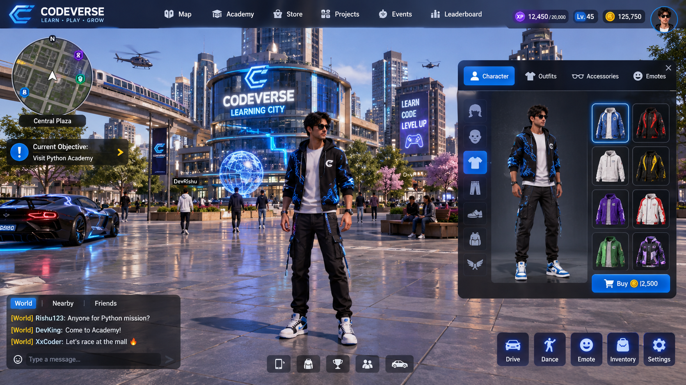

# Official CodeVerse visual reference

**This user-supplied image is the official visual benchmark for all future graphics milestones.** It is an art-direction reference, not a screenshot of a working CodeVerse build or proof of browser feasibility.

- Original attachment: `CodeVerse Central Plaza Customization.png`
- Preserved file: `codeverse-central-plaza-customization.png`
- Preserved on: 2026-11-27, without resizing, recompression, or editing
- SHA-256: `15e0f43b14035914418099dacd15a40759139aa36dd519dde502edd4d0744915`
- Provenance: supplied by the project owner in the Milestone 0 brief/approval. No broader third-party asset rights are assumed from the attachment.

## Evaluation anchors

- Detailed modern fictional architecture, coherent scale, streetscape, vegetation, and props.
- Premium PBR material response and cinematic lighting; controlled blue accents.
- Realistic/stylized-realistic rendering, not low-poly or primitive placeholders.
- High consistency of asset detail, palette, typography, and eventual HUD treatment.
- Detailed characters/clothing and smooth third-person framing are future quality targets, **not authorization to implement character systems now**.

The store, map, chat, player progression, customization, vehicles, and crowds depicted here express the long-term vision. They must not be copied into a nonfunctional HUD or treated as current functionality.

Every future graphics milestone must cite this reference, define which aspects it tests and which remain untested, supply real-time captures, and obtain review. Do not hide scene-quality gaps behind a static image, pre-rendered video, mock HUD, or selective camera view. Do not lower the visual standard without explaining the measured limitation and proposing a remedy for approval.
